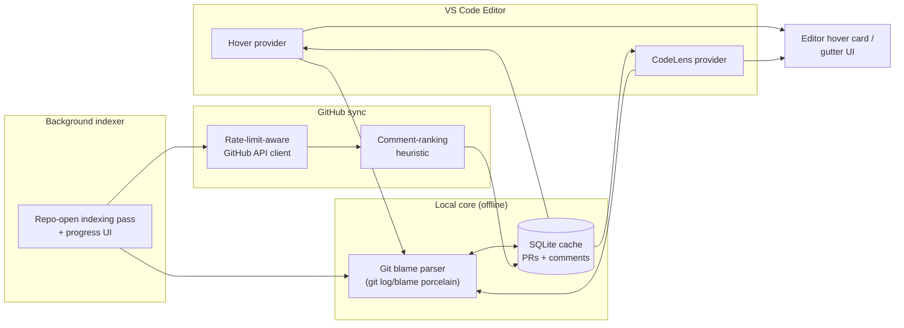

# ContextLens


**Hover over any line of code and see who wrote it, why, and what the PR discussion actually said — without leaving your editor.**

## The problem

The reasoning behind a tricky line of code almost never lives next to that line. It lives in a PR description someone wrote six months ago, or buried on page three of a review thread, or in a Slack message nobody can find anymore. So engineers re-derive the same "why is this here?" question over and over — during onboarding, during code review, during an incident at 2am — burning time that the original author already spent explaining once. `git blame` gets you a commit hash and a one-line summary; it doesn't get you the actual conversation.

ContextLens closes that gap. It blames the line, follows the commit to the pull request that introduced it, fetches that PR's description and top comments from GitHub, ranks them by how explanatory they actually are, and surfaces all of it in a hover card — cached locally so it's instant on every subsequent look.

## Architecture



VS Code's hover/CodeLens providers ask the local git blame parser + SQLite cache for context first (always available, always offline). A background indexer walks the repo's history on open, discovers which commits reference a pull request, and drives a rate-limit-aware GitHub API sync that fetches PR descriptions and comments for those references. Fetched comments are passed through a comment-ranking heuristic before being cached, so what eventually reaches the editor gutter/hover UI is already sorted by "how likely is this to explain *why*," not just chronological order.

## Quick start

```bash
npm install
npm run build     # tsc compile, produces dist/extension.js
npm test           # vitest — fully offline, no GitHub token needed

# Try it inside VS Code:
#   1. Open this folder in VS Code
#   2. Press F5 to launch an Extension Development Host
#   3. Open any git-tracked file in a repo with a GitHub origin remote
#   4. Hover over a line to see its blame chain
#   5. Run "ContextLens: Open Settings" to add a GitHub token and unlock
#      PR descriptions + ranked comments in the hover card
```

Packaging a distributable `.vsix`:

```bash
npm run build
npx vsce package --no-dependencies
```

## How it works

1. **Hover / CodeLens trigger.** When you hover a line (or view a CodeLens above a function/class), the extension runs `git blame --line-porcelain -L <line>,<line>` scoped to that exact line — cheap enough to run synchronously per hover.
2. **Blame chain parsing.** `src/gitBlame.ts` parses the porcelain output into a deduplicated, newest-first chain of commits touching that line, extracting any PR number referenced in the commit subject (`Merge pull request #123 …` or the squash-merge `... (#123)` convention).
3. **Cache lookup.** If the newest linked PR is already cached and fresh (TTL configurable via `contextlens.cacheTtlHours`), its description and ranked comments are read straight out of the local SQLite database (`src/sqliteCache.ts`, backed by `sql.js` — no native build step, no filesystem lock contention).
4. **GitHub sync on a cache miss.** `src/githubClient.ts` fetches the PR plus its issue-level and review-line comments, respecting GitHub's rate-limit headers: on primary limit exhaustion it surfaces a clear "rate limited, resets at …" state instead of retrying blindly; on secondary rate limits / 5xx it retries with the `Retry-After` hint or exponential backoff.
5. **Comment ranking.** `src/commentRanking.ts` scores each comment on reaction count, author association (maintainer/PR-author vs. drive-by), whether it's anchored to a diff line, presence of explanatory language ("because", "root cause", "workaround", …), and length — then penalizes pure ceremony ("LGTM", "+1"). The top N (default 3) are shown.
6. **Background indexing.** On repo open, `src/indexer.ts` walks recent `git log` history (`src/gitLogParser.ts`) to find every commit that references a PR, then pre-warms the cache for the most recent ones inside a cancellable VS Code progress notification — so the *first* hover on a hot file is already fast.
7. **Settings.** `ContextLens: Open Settings` opens a small webview for entering a GitHub token; it's written to VS Code's `SecretStorage` (OS keychain), never to `settings.json`.

### Design choices worth calling out

- **`sql.js` over a native SQLite binding.** Avoids native-module compile/prebuild friction across VS Code's supported platforms and Node versions, at the cost of loading a small WASM binary once per extension host process.
- **Dependency-injected `fetch` and `sleep`.** `GitHubClient` takes both as constructor options, so its retry/backoff/rate-limit logic is fully unit-testable with a fake transport and no real network or timers.
- **Real-git integration tests, not fixture strings.** Several tests spin up a throwaway repo in a temp directory and run the actual `git` binary, so the blame/log parsers are verified against git's real output format rather than a hand-written approximation of it.

## Testing

```bash
npm test          # vitest: parser unit tests, ranking heuristic, cache,
                   # rate-limit handling, and real-git integration tests
npm run lint       # ESLint
npm run build      # TypeScript compile (also the extension bundling step)
```

Everything above runs fully offline: no GitHub token, no Docker daemon, no network access required. The only external binary the tests shell out to is `git` itself, against repositories created on the fly in a temp directory.

## Configuration

| Setting | Default | Description |
|---|---|---|
| `contextlens.githubToken` | _(unused directly — see below)_ | Token is entered via **ContextLens: Open Settings** and stored in SecretStorage, not this setting. |
| `contextlens.maxCommentsPerHover` | `3` | Max ranked PR comments shown per hover. |
| `contextlens.blameLineLimit` | `4000` | Skip indexing files larger than this many lines. |
| `contextlens.cacheTtlHours` | `168` | Hours before a cached PR record is considered stale. |
| `contextlens.showCodeLens` | `true` | Toggle the "Last touched by…" CodeLens annotations. |

## Commands

- `ContextLens: Re-index Repository` — runs the background indexer on demand with progress UI.
- `ContextLens: Open Settings` — opens the token-entry webview.
- `ContextLens: Clear Local Cache` — wipes the SQLite cache.

## License

MIT — see [LICENSE](LICENSE).
